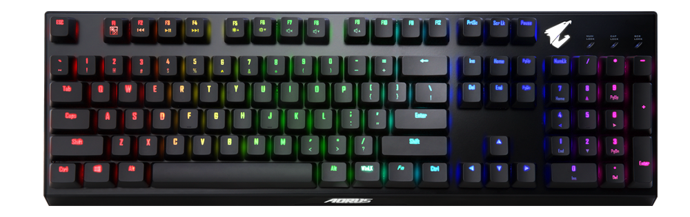

# AORUS K9 Optical for SignalRGB

Thank you to **@amazed_by_stuff** for recording and sharing the Wireshark USB captures in [OpenRGB #413](https://gitlab.com/CalcProgrammer1/OpenRGB/-/work_items/413). Those recordings made the protocol investigation and this plugin possible.

A custom SignalRGB USB HID plugin for the **GIGABYTE AORUS K9 Optical** keyboard (`1044:7A35`). It adds uniform effect synchronization, static per-key colors, the keyboard's built-in animations, brightness control, and an embedded device image.

Author and maintainer: [Igoryok95](https://github.com/Igoryok95).

# LIVE PER-KEY ANIMATIONS ARE LIKELY NOT FIXABLE WITH THE CURRENT CONTROLLER PROTOCOL

**LIVE PER-KEY ANIMATIONS FLICKER ON THE TESTED K9. THIS IS LIKELY A CONTROLLER / FIRMWARE LIMITATION, NOT SOMETHING A NORMAL SIGNALRGB PLUGIN CAN FIX.**

Even repeatedly transmitting an unchanged per-key color frame caused visible flicker. Uniform color updates and the keyboard's own animations work differently. A different real-time device protocol or different firmware would be needed to reconsider this conclusion; the vendor has not confirmed the internal cause.

Continuous per-key streaming is **not included in the released mode list**. Static per-key painting remains available. Rainbow, NeonShift, screen effects, and other SignalRGB animations can control one shared keyboard color, while the built-in modes provide standalone per-key animation.

**UNIFORM COLOR MODE IS RECOMMENDED. Per-key mode only conditionally works for static, non-animated lighting and is provided on a best-effort basis.**

Tracked in [Known limitation #1](https://github.com/Igoryok95/signalrgb-aorus-k9/issues/1).



## Installation

1. Download **one** plugin from `dist/`:
   - [English controls](dist/AORUS_K9_SignalRGB.js)
   - [Russian controls](dist/AORUS_K9_SignalRGB.ru.js)
2. Copy the selected file into `%USERPROFILE%\Documents\WhirlwindFX\Plugins\`.
3. Restart SignalRGB. The device appears as **AORUS K9 Optical**.
4. Use **SignalRGB effect: uniform color** for normal effect synchronization, or select one of the **Keyboard:** firmware effects.

Install only one language variant: both files target the same keyboard. The PNG is embedded in the plugin, so no separate image download or absolute image path is required.

Close AORUS Engine, RGB Fusion, and OpenRGB before using the keyboard in SignalRGB.

## Features

- 104 ANSI keys and the AORUS logo.
- Static individual colors through SignalRGB LED painting.
- A uniform effect color or a fixed RGB color for the whole keyboard.
- Standard SignalRGB brightness control.
- Built-in rainbow wave, breathing, ripple on keypress, and reactive-key modes.
- No repeating bulk writes while static colors or firmware effects are idle.
- Optional update statistics and a configurable shutdown color.
- A strict HID interface filter: interface `0`, usage page `FF02`, usage `1`. Keyboard and mouse input interfaces are not opened.

Firmware effects and fixed colors override canvas animation. The device pulse/identify button follows the canvas in uniform SignalRGB mode.

## Painting individual keys

This is a best-effort static mode. Uniform color remains the recommended option for everyday use.

1. Select a solid SignalRGB canvas effect, turn off its breathing option, or pause the active animation.
2. Select **Static per-key colors** in the K9 lighting settings.
3. Open the device's **Paint** / LED painting panel and assign colors to individual keys.
4. After the colors remain unchanged for 500 ms, the plugin writes one complete color table. Updates are limited to one table per second and identical tables are not resent.

A continuously changing canvas is deliberately ignored in this mode. This preserves individual static colors without restarting the flickering animation stream. The static table is retained in the keyboard while switching to and from firmware or uniform modes.

## Validation and limitations

The plugin was developed from USB captures and tested on a connected AORUS K9 Optical with SignalRGB 2.5.86 on Windows. Uniform color, Esc/WASD/arrows, complete row mapping, canvas identification, and the embedded image were checked on the physical device. Automated tests cover both English and Russian builds.

In a follow-up check, the maintainer reported that the final modes worked as expected and the keyboard responded normally. This is user-observed validation, not a measured input-latency or system frame-time test.

An experimental HID stream completed **800 per-key frames in 20 seconds at 40 updates/s**, followed by a matching 512-byte readback. Physical testing still showed flicker, including with an unchanged frame. That transport result is **not a supported animation rate** and is not an optical measurement of LED refresh frequency.

The final plugin uses the captured firmware commands and a settled, changed-frame-only static writer. See [test findings](docs/test-findings.md) for the distinction between successful USB transfer and usable lighting.

See [protocol notes](docs/protocol.md) for the packet format and readback constraints. Only the tested ANSI K9 (`1044:7A35`) is enabled; the AORUS laptop IDs discussed in the references use a different key-data layout.

## Build and test

Node.js 20 or newer is sufficient; there are no npm dependencies.

```sh
npm run build
npm test
```

The build embeds `assets/aorus-k9.png` and creates standalone English and Russian plugins. Tests check interface isolation, packet lengths and checksums, LED mapping, static-painting debounce, suppression of a changing canvas, native mode caching, uniform-color gamut, brightness, and suspend behavior. They use a simulated HID device and do not write to hardware.

## References and image credits

- [Original AORUS K9 USB captures — OpenRGB #413](https://gitlab.com/CalcProgrammer1/OpenRGB/-/work_items/413)
- [Related AORUS laptop protocol — OpenRGB #3403](https://gitlab.com/CalcProgrammer1/OpenRGB/-/issues/3403)
- [SignalRGB plugin documentation](https://docs.signalrgb.com/developer/plugins/)
- [GIGABYTE AORUS K9 Optical](https://www.gigabyte.com/Keyboard/AORUS-K9-Optical)

The keyboard product image was supplied by the maintainer. GIGABYTE and AORUS names, trademarks, and product imagery belong to their respective owners. The MIT license covers the plugin code and build scripts; it does not relicense the product image.
